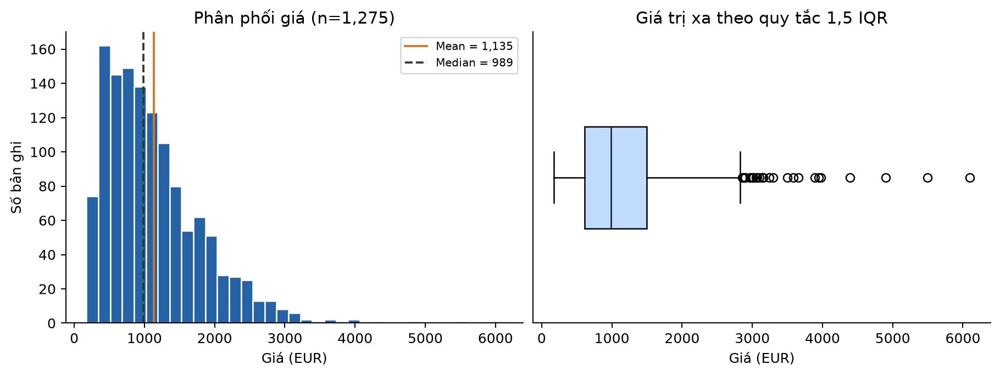
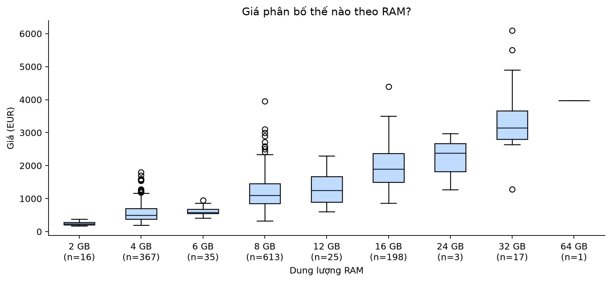
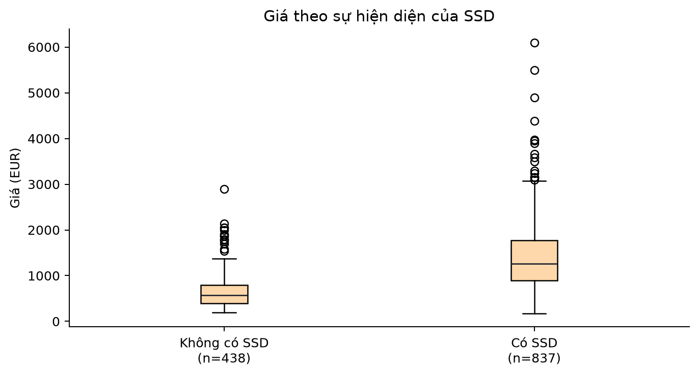
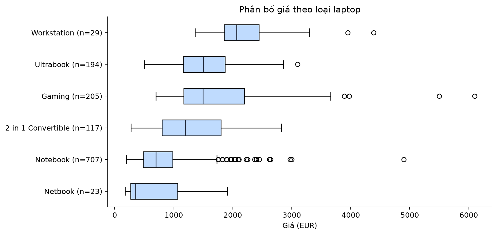
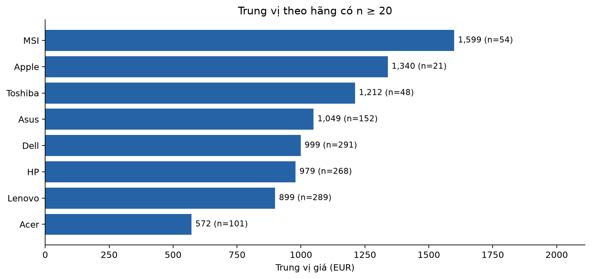
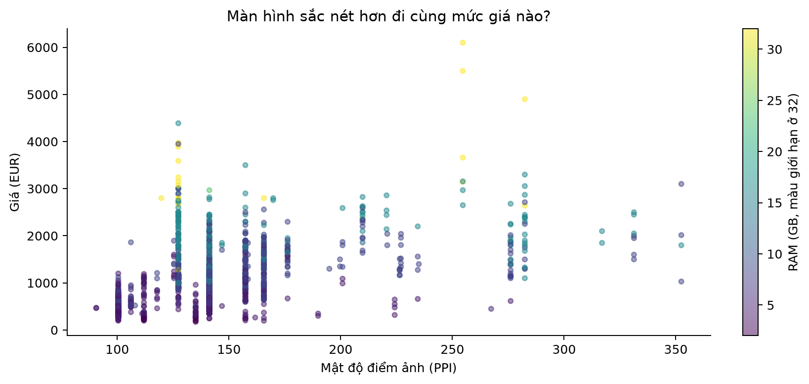
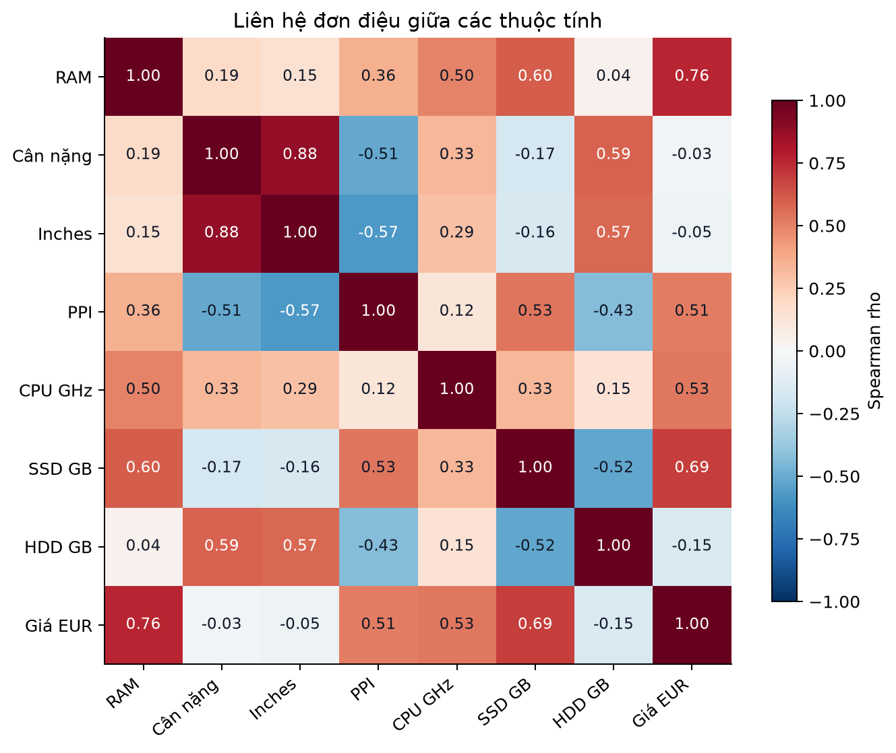

# Phân tích giá laptop

Bản thảo nội dung - Mid-term 2, đề 6

Đại học Kinh tế Quốc dân  
Viện Đào tạo Tiên tiến, Chất lượng cao và POHE  
Học phần: Khoa học dữ liệu  
Nhóm 1

| Họ và tên | Mã sinh viên |
| --- | --- |
| Trần Hương Nhi | 11243708 |
| Nguyễn Thúy Anh | 11243888 |
| Trần Minh Ngọc | 11242573 |
| Đàm Phương Linh | 11243309 |

## 1. Thu thập và đánh giá dữ liệu ban đầu

Đề tài 6: Laptop Price. Mục tiêu là mô tả phân khúc giá và đánh giá mối liên hệ giữa giá với RAM, lưu trữ, loại máy và màn hình. Bài này tập trung vào phân tích theo mục II của đề; không bổ sung mô hình dự đoán khi chưa có yêu cầu riêng.

Nguồn được chỉ định trong đề: [Laptop Price - Kaggle, muhammetvarl](https://www.kaggle.com/datasets/muhammetvarl/laptop-price). Phân tích sử dụng đúng bản CSV do người học cung cấp, không thay thế bằng phiên bản tải từ nơi khác. Một dòng được coi là một bản ghi mô tả cấu hình và giá, không coi là một giao dịch bán hàng.

Tập gốc có 1.303 dòng, 13 thuộc tính trong một file CSV, không cần ghép bảng. File được đọc với encoding latin-1 để giữ các ký tự trong nhãn sản phẩm. Không có trường thời gian ghi nhận, quốc gia, số lượng bán hay khách hàng; vì vậy không phân tích xu hướng theo thời gian hoặc thị phần bán hàng.

| Thuộc tính | Kiểu ý nghĩa | Nội dung và vai trò |
| --- | --- | --- |
| laptop_ID | Số nguyên | Mã bản ghi; giữ để truy vết, không dùng làm biến giải thích |
| Company | Phân loại | Hãng sản xuất; 19 giá trị |
| Product | Văn bản | Tên sản phẩm; cùng tên có thể có nhiều cấu hình |
| TypeName | Phân loại | Loại laptop; 6 nhóm |
| Inches | Số thực | Kích thước đường chéo màn hình, inch |
| ScreenResolution | Văn bản | Độ phân giải và mô tả IPS/Touchscreen |
| Cpu | Văn bản | Nhãn CPU và xung nhịp GHz |
| Ram | Văn bản | Dung lượng RAM, có hậu tố GB |
| Memory | Văn bản | Dung lượng và loại từng ổ lưu trữ |
| Gpu | Văn bản | Nhãn GPU |
| OpSys | Phân loại | Hệ điều hành |
| Weight | Văn bản | Trọng lượng, có hậu tố kg |
| Price_euros | Số thực | Giá laptop theo EUR; biến kết quả phân tích |

Kiểm tra toàn bộ 13 cột cho thấy 0 ô thiếu, 0 chuỗi rỗng sau khi bỏ khoảng trắng và 0 mã laptop_ID trùng. Có 0 dòng trùng khi xét đủ 13 cột nhưng 28 bản ghi dư khi bỏ laptop_ID khỏi khóa so sánh. Bảng chi tiết kiểu dữ liệu, số giá trị phân biệt và tỷ lệ thiếu nằm trong reports/tables/01_data_audit.csv.

Ba câu hỏi kiểm định là: RAM có liên hệ đồng biến với giá không? Nhóm có SSD có xu hướng giá cao hơn không? Phân phối giá có khác nhau giữa các TypeName không? Các kiểm định được trình bày như phân tích khám phá trên mẫu hiện có, không phải giả thuyết được đăng ký trước trên một mẫu xác nhận độc lập.

## 2. Tiền xử lý và làm sạch

Các cột Ram, Weight, Memory và ScreenResolution có thông tin số nằm trong chuỗi. Chúng không phải giá trị thiếu; vấn đề là định dạng chưa thích hợp cho tính toán. Giữ lại trường gốc và tạo các trường số để đối chiếu.

| Trường mới | Cách tạo và giải trình |
| --- | --- |
| Ram_GB | 8GB thành 8; tránh so sánh theo thứ tự chuỗi |
| Weight_kg | 1.37kg thành 1.37; giữ đơn vị kg |
| ScreenWidth_px, ScreenHeight_px | Tách 2560x1600 thành 2560 và 1600 |
| PPI | sqrt(width^2 + height^2) / Inches; xét độ phân giải cùng kích thước |
| IPS, Touchscreen | Cờ Boolean từ mô tả màn hình |
| Cpu_GHz, Cpu_brand, Gpu_brand | Tách xung nhịp và nhãn hãng; GHz không đồng nghĩa hiệu năng |
| SSD_GB, HDD_GB, Flash_GB, Hybrid_GB | Tách từng ổ, cộng ổ cùng loại; quy ước 1 TB = 1000 GB |
| Has_SSD | SSD_GB > 0; không tự coi Flash Storage là SSD |
| Price_IQR_flag | Cờ ngoài [Q1 - 1.5 IQR; Q3 + 1.5 IQR] |

Ví dụ Memory: 128GB SSD + 1TB HDD thành SSD_GB=128, HDD_GB=1000; 1TB HDD + 1TB HDD thành HDD_GB=2000; 1.0TB Hybrid thành Hybrid_GB=1000. Không dùng cách lấy mọi chữ số trong cả chuỗi vì sẽ làm sai ổ kép. Bộ tách báo lỗi khi gặp định dạng không nhận diện, thay vì im lặng gán 0.

Về trùng lặp, so sánh toàn bộ 12 trường ngoài ID rồi giữ bản đầu tiên, giảm từ 1.303 xuống 1.275 bản ghi. Ví dụ các ID 1279, 1293, 1307 có cùng nội dung ngoài ID. Quyết định này tránh đếm lặp cùng cấu hình-giá trong phân tích mô tả; CSV không cung cấp thời điểm hoặc nơi niêm yết để xác nhận đây là các niêm yết độc lập. Không xóa theo Product vì cùng tên sản phẩm có thể có cấu hình khác nhau. Bảng minh chứng chứa tất cả thành viên của các nhóm trùng nằm trong 04_duplicate_evidence.csv, nên số dòng trong bảng đó lớn hơn số bản ghi bị loại.

Không điền Mean/Median vì không phát hiện giá trị thiếu. Các trường số tạo ra đều được kiểm tra thiếu và điều kiện dương khi phù hợp; không phát hiện giá không dương. Không cần one-hot encoding hoặc StandardScaler cho thống kê mô tả và kiểm định theo hạng. Không mã hóa hãng thành các số thứ tự vì sẽ tạo ra thứ bậc không có thật. Nếu sau này thêm mô hình, việc fit bộ mã hóa/chuẩn hóa phải thực hiện trên tập huấn luyện.

Sau bỏ trùng, Q1=609.00, Q3=1,496.50, IQR=887.50 EUR. Ngưỡng dưới là -722.25 và ngưỡng trên 2,827.75 EUR. Có 28 bản ghi (2.20%) được gắn cờ, đều ở phía giá cao. Đây là 28 cờ ngoại lệ, khác với 28 bản ghi trùng đã loại. Giữ tất cả cờ ngoại lệ trong phân tích chính vì chưa có bằng chứng sai nhập liệu; giá cao nhất 6,099.00 EUR được giữ lại. Dùng thêm phân tích độ nhạy khi bỏ các cờ để xem kết luận có bị chi phối hay không.

## 3. Phân tích và trực quan hóa

Phạm vi các biểu đồ dưới đây là 1.275 bản ghi sau bỏ trùng, gồm cả 28 cờ IQR. Giá giữ nguyên đơn vị EUR; không quy đổi sang VND khi không có ngày giá và tỷ giá tương ứng. Các số trong nhận định được tính từ dữ liệu, không giả lập.

## 3.1. Phân phối giá

Hình 1. Giá có phân phối lệch phải: trung bình 1,134.97 EUR cao hơn trung vị 989.00 EUR; hệ số lệch 1.51. Khoảng giữa 50% bản ghi là 609.00-1,496.50 EUR. Có 28 bản ghi vượt ngưỡng IQR trên 2,827.75 EUR; các điểm này được giữ lại vì có thể thuộc phân khúc cao cấp. Trung vị và IQR mô tả mức giá điển hình phù hợp hơn chỉ dùng trung bình.

## 3.2. RAM và giá

Hình 2. RAM liên hệ đồng biến mạnh với giá trong mẫu (Spearman rho=0.764). Trung vị các nhóm 4 GB, 8 GB và 16 GB lần lượt là 498.00, 1,099.00 và 1,895.00 EUR, với cỡ mẫu tương ứng 367, 613 và 198. Nhóm 24 GB chỉ có 3 bản ghi và 64 GB chỉ có 1 bản ghi, nên không suy rộng xu hướng từ hai nhóm này. Chênh lệch giữa các nhóm không phải mức tăng giá do riêng việc nâng cấp RAM.

## 3.3. SSD và giá

Hình 3. Nhóm có SSD gồm 837 bản ghi, trung vị 1,265.00 EUR; nhóm không có SSD gồm 438 bản ghi, trung vị 567.00 EUR. Chênh lệch trung vị là 698.00 EUR; khoảng bootstrap phân vị 95% từ 2000 lần lấy mẫu lại là [612.00; 755.50] EUR. Đây là chênh lệch giữa hai nhóm cấu hình, có thể chịu ảnh hưởng của RAM, CPU, hãng và loại máy; không phải chi phí lắp thêm SSD. Flash Storage không được tự gộp vào SSD.

## 3.4. Loại laptop và giá

Hình 4. Workstation có trung vị 2,064.90 EUR (n=29), Notebook 695.00 EUR (n=707), Netbook 355.00 EUR (n=23). Gaming và Ultrabook có trung vị lần lượt 1,492.80 và 1,499.00 EUR. Phân bố giữa các loại vẫn chồng lấn; loại máy giúp phân đoạn nhu cầu nhưng không quyết định hoàn toàn giá. Kiểm định tổng thể không cho biết cặp loại nào khác biệt có ý nghĩa.

## 3.5. Hãng và giá

Hình 5. Trong các hãng có ít nhất 20 bản ghi, MSI có trung vị 1,599.00 EUR (n=54), Apple 1,339.69 EUR (n=21) và Acer 572.00 EUR (n=101). Ngưỡng n>=20 được chọn để hạn chế diễn giải nhóm quá nhỏ, không phải tiêu chuẩn bảo đảm tính đại diện. Các hãng dưới ngưỡng vẫn được giữ trong dữ liệu và bảng đầy đủ. Đây là so sánh cơ cấu sản phẩm trong mẫu, chưa tách được phần giá gắn với thương hiệu khi cùng cấu hình.

## 3.6. Mật độ điểm ảnh và giá

Hình 6. Mật độ điểm ảnh PPI có liên hệ đồng biến với giá (rho=0.511), nhưng tại cùng PPI giá vẫn phân tán rộng. Màu RAM cho thấy thuộc tính màn hình và cấu hình có thể đi cùng nhau. PPI chỉ phản ánh độ sắc nét theo độ phân giải và kích thước, không đại diện đầy đủ cho chất lượng tấm nền, độ sáng hay độ chính xác màu. Không nên dùng riêng PPI để định giá.

## 3.7. Tương quan giữa các thuộc tính

Hình 7. Trong các biến được đưa vào heatmap, tương quan với giá nổi bật ở RAM (rho=0.764) và SSD_GB (rho=0.689); PPI có rho=0.511. Weight_kg có rho=-0.025, gần 0, nhưng điều này không loại trừ liên hệ phi tuyến hoặc khác biệt trong từng phân khúc. RAM và SSD_GB có rho=0.602, cho thấy các cấu hình thường đi kèm nhau. Cpu_GHz không đo đầy đủ hiệu năng CPU giữa các thế hệ. Các tương quan là mô tả, không chứng minh tác động độc lập hay nhân quả.

## 3.8. Kiểm định giả thuyết và độ lớn khác biệt

Chọn mức ý nghĩa alpha=0,05. Do giá lệch phải và RAM là biến rời rạc, dùng kiểm định theo hạng thay vì mặc định phân phối chuẩn. Thực hiện ba kiểm định chính và điều chỉnh p-value bằng Holm cho cả họ kiểm định. Các p-value là xấp xỉ; không diễn giải p-value là xác suất H0 đúng hay là độ lớn tác động.

H1: H0 là rho(RAM, giá)=0; H1 là rho>0. Spearman một phía đo mối liên hệ đơn điệu, xử lý các giá trị RAM bằng nhau qua xếp hạng trung bình. Kết quả rho=0.764 cho thấy liên hệ đồng biến mạnh trong mẫu.

H2: H0 là hai phân phối giá của nhóm có SSD và không SSD giống nhau; H1 là nhóm có SSD có xu hướng giá cao hơn. Mann-Whitney một phía dùng xấp xỉ có hiệu chỉnh ties. U/(n1*n0)=0.864, tức xác suất một bản ghi SSD có giá cao hơn một bản ghi không SSD, cộng nửa xác suất bằng giá, xấp xỉ 86.4% khi lấy ngẫu nhiên từ hai nhóm trong mẫu. Kiểm định này không tự động là kiểm định chênh lệch trung vị khi hình dạng phân phối khác nhau.

H3: H0 là các phân phối giá theo TypeName giống nhau; H1 là có khác biệt ở ít nhất một nhóm. Kruskal-Wallis cho H=545.561 với 6 nhóm; nhóm nhỏ nhất có 23 bản ghi. Chỉ diễn giải như khác biệt về vị trí/trung vị khi các nhóm có hình dạng phân phối tương tự; ở đây kết luận thận trọng về phân phối/thứ hạng. Epsilon-squared H=(H-k+1)/(n-k)=0.426 là chỉ số độ lớn khác biệt tổng thể. Chưa thực hiện hậu kiểm, nên không tuyên bố từng cặp đều khác biệt.

| Giả thuyết | Kiểm định | Thống kê | p gốc | p Holm | Quyết định |
| --- | --- | --- | --- | --- | --- |
| H1 RAM-price | Spearman greater | 0.7642 | 4.651e-245 | 1.395e-244 | Bác bỏ H0 |
| H2 SSD-price | Mann-Whitney greater | 316661.0000 | 1.600e-101 | 1.600e-101 | Bác bỏ H0 |
| H3 type-price | Kruskal-Wallis | 545.5611 | 1.162e-115 | 2.325e-115 | Bác bỏ H0 |

Cả ba H0 đều bị bác bỏ ở alpha=0,05 sau điều chỉnh Holm. Đây là bằng chứng về liên hệ trong mẫu theo giả định các bản ghi độc lập. Cùng một dòng sản phẩm có thể xuất hiện dưới nhiều cấu hình, nên độc lập chỉ là xấp xỉ; mẫu không ngẫu nhiên cũng hạn chế suy rộng ra thị trường. Khoảng bootstrap SSD chỉ phản ánh bất định khi lấy mẫu lại từ dữ liệu hiện có và không bao gồm sai lệch chọn mẫu hoặc biến gây nhiễu.

## 3.9. Kiểm tra độ nhạy

| Kịch bản | n | Trung vị EUR | rho RAM-giá | Chênh trung vị SSD EUR |
| --- | --- | --- | --- | --- |
| raw_with_duplicates | 1303 | 977.00 | 0.769 | 700.90 |
| deduplicated_main | 1275 | 989.00 | 0.764 | 698.00 |
| without_IQR_flags_sensitivity_only | 1247 | 977.00 | 0.753 | 661.49 |

Khi giữ bản ghi trùng, bỏ trùng hoặc tạm loại cờ IQR, rho RAM-giá nằm trong khoảng 0.753-0.769, vẫn dương mạnh. Chênh trung vị SSD vẫn dương, khoảng 661.49-700.90 EUR. Cả ba kiểm định vẫn có p Holm<0,05 ở ba kịch bản. Vì vậy hướng kết luận chính không phụ thuộc riêng vào quyết định bỏ trùng hay một số mức giá cao. Kịch bản bỏ cờ IQR chỉ là đối chiếu, không thay thế mẫu chính. Bảng 03_sensitivity.csv lưu cả p-value để kiểm tra lại.

## 4. Đánh giá tác động và khuyến nghị

Phát hiện chính: mức giá điển hình trong mẫu là trung vị 989.00 EUR; RAM và lưu trữ SSD liên hệ rõ với giá, còn loại laptop giúp nhận diện phân khúc. Hãng có mức giá khác nhau nhưng chưa thể quy phần chênh lệch cho riêng thương hiệu. Các khuyến nghị sau là đề xuất dựa trên cấu trúc mẫu, chưa phải hiệu quả kinh doanh đã được thử nghiệm.

Đối với người mua: xác định nhóm nhu cầu trước khi so sánh giá. Dùng các nhóm RAM 4/8/16 GB và loại laptop để chọn các máy tương đồng, rồi đối chiếu CPU, GPU, SSD và màn hình. Trung vị nhóm là mức tham khảo từ bộ dữ liệu này, không phải báo giá laptop hiện tại.

Đối với đơn vị kinh doanh: có thể xây bảng tham khảo giá theo loại máy và cấu hình, dùng trung vị/IQR để hạn chế ảnh hưởng của vài sản phẩm rất đắt. Khi rà soát mức niêm yết bất thường, xem lại mô tả cấu hình trước khi kết luận sai giá. Dữ liệu không có doanh số, lợi nhuận hoặc tồn kho, nên chưa đủ để quyết định tỷ trọng nhập hàng hay tối ưu doanh thu.

Đối với chất lượng dữ liệu: lưu dung lượng và loại ổ ở trường riêng, trọng lượng dạng số kèm đơn vị, giữ mã truy vết và kiểm tra trùng theo cấu hình-giá. Bổ sung thời điểm, nơi niêm yết, tình trạng mới/cũ, bảo hành và thế hệ CPU/GPU sẽ giúp so sánh công bằng hơn.

Giới hạn: đây là tập dữ liệu tiện lợi với cơ cấu hãng/loại máy mất cân bằng; một số nhóm chỉ 1-3 bản ghi. CSV không nêu thời điểm và khu vực giá, không có lịch sử giao dịch, thuế, giảm giá hoặc phiên bản cấu hình đầy đủ. Dữ liệu quan sát không tách được tác động độc lập của RAM, SSD hay thương hiệu. Kiểm định và bootstrap giả định độc lập xấp xỉ giữa bản ghi. Quy ước TB=1000 GB và quy tắc bỏ trùng có thể được thay đổi nếu có tài liệu nguồn rõ hơn.

Hướng mở rộng: bổ sung dữ liệu có ngày và quốc gia, thiết lập khóa sản phẩm/cấu hình rõ ràng, kiểm tra cụm theo dòng sản phẩm. Nếu thêm dự đoán giá, so sánh baseline với mô hình hồi quy bằng MAE/RMSE và cross-validation; chia nhóm theo sản phẩm để hạn chế lọt cấu hình tương tự giữa train/test; fit preprocessing trong từng fold. Phần mô hình này chưa được thực hiện và không phải kết quả của báo cáo hiện tại.

## 5. Tái lập và tài liệu tham khảo

Notebook 06_laptop_price.ipynb chứa mã xử lý và diễn giải; chỉ cần file laptop_price.csv để chạy, không phụ thuộc các file kết quả tạo sẵn. Các bước có comment tiếng Việt. Mã nguồn tương ứng nằm trong src/laptop_analysis.py. Cố định seed=42 cho bootstrap 2000 lần. SHA-256 của bản CSV và phiên bản thư viện được ghi trong reports/results.json; chạy trên môi trường thư viện khác có thể chênh lệch rất nhỏ về số thực hoặc biểu diễn hình.

Tài liệu dùng để xây dựng bài:

- Đề Mid-Term 2 do giảng viên cung cấp, mục II: bốn giai đoạn phân tích và yêu cầu notebook/GitHub.
- [Laptop Price, muhammetvarl, Kaggle](https://www.kaggle.com/datasets/muhammetvarl/laptop-price): URL dữ liệu theo đề; các thống kê trong bài tính trực tiếp từ CSV được cung cấp.
- [SciPy - Spearman](https://docs.scipy.org/doc/scipy/reference/generated/scipy.stats.spearmanr.html): tương quan theo hạng và kiểm định một phía.
- [SciPy - Mann-Whitney U](https://docs.scipy.org/doc/scipy/reference/generated/scipy.stats.mannwhitneyu.html): kiểm định hai mẫu độc lập, ties và cách diễn giải.
- [SciPy - Kruskal-Wallis](https://docs.scipy.org/doc/scipy/reference/generated/scipy.stats.kruskal.html): kiểm định tổng thể nhiều nhóm, không thay thế hậu kiểm.

Nguồn logo trên bìa: [Hệ thống nhận diện NEU](https://neu.edu.vn/he-thong-nhan-dien/) và [Viện AEP](https://aep.neu.edu.vn/). File logo AEP độ phân giải gốc được trích xuất nguyên vẹn từ ảnh nhúng trong SVG của website chính thức; thông tin nguồn nằm trong assets/branding/sources.json.

Bản thảo đã có bìa Đại học Kinh tế Quốc dân, Viện Đào tạo Tiên tiến, Chất lượng cao và POHE, cùng thông tin bốn thành viên Nhóm 1. Cần thêm URL GitHub public thực tế và rà soát lần cuối trước khi nộp. Chưa có thao tác tạo hoặc đẩy repository GitHub trong bộ tài liệu này.
